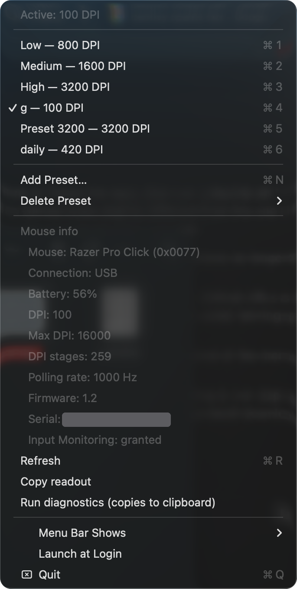

# DPIBar

A small menu bar app for macOS that lets you change the DPI of a Razer mouse, save your own presets, and see live info about the mouse, without installing Razer's software.

<!-- Add a screenshot of the menu here, e.g.  -->

## Features

- **One-click DPI presets.** Pick a preset from the menu, or press `1`–`9` while the menu is open. Starts with Low (800), Medium (1600) and High (3200).
- **Your own presets.** Add a named preset with any DPI the mouse supports, and delete the ones you don't want.
- **Follows the mouse's own DPI button.** When you change DPI with the button on the mouse, the menu bar updates within about a second.
- **Menu bar display you control.** Show the mouse icon, the DPI, the battery percentage, or any mix of the three.
- **Only offers what your mouse can do.** Presets above the connected model's maximum DPI don't appear in the menu.
- **Remembers your DPI per mouse** and re-applies it when the mouse is reconnected.
- **Mouse info readout.** Battery and charging state, current DPI, maximum DPI, DPI stages, polling rate, firmware version, serial number and connection type, with a button to copy it all.
- **Launch at Login.**
- **Built-in diagnostics** for bug reports (see [Reporting a problem](#reporting-a-problem)).

## Supported mice

Developed and tested on a **Razer Pro Click V1**. Maximum DPI limits for a few other models (Basilisk V3 variants, Pro Click V2 and Mini) are in the `knownMax` table at the top of `DPIBar.swift`, but those models are untested. A mouse that isn't in the table still works and falls back to a 16000 DPI limit. You can add your model to the table.

The app uses the same USB command protocol documented by the [OpenRazer](https://openrazer.github.io/) project, so other Razer mice that follow it may work too.

## Requirements

- macOS 13 or newer (developed on an Apple silicon Mac)
- The Xcode Command Line Tools, which provide the Swift compiler
- The mouse connected by **USB cable or the 2.4 GHz wireless dongle**. **Bluetooth is not supported**, because the mouse doesn't accept DPI commands over Bluetooth.

## Build and install

There's no prebuilt download yet, so you build it from source. It takes about a minute and needs no Xcode project.

**1. Install the command line tools** (skip if `swiftc --version` already works):

```bash
xcode-select --install
```

**2. Put these files in one folder:**

```
DPIBar.swift     the app source
MenuIcon.png       optional menu bar icon (see "Custom menu bar icon" below)
build.sh           the build script below
```

**3. Save this as `build.sh`:**

```bash
#!/bin/bash
set -e
cd "$(dirname "$0")"

APP="DPIBar.app"
rm -rf "$APP"
mkdir -p "$APP/Contents/MacOS" "$APP/Contents/Resources"

# 1. Compile
swiftc -O DPIBar.swift -o "$APP/Contents/MacOS/DPIBar"

# 2. Optional custom menu bar icon
if [ -f MenuIcon.png ]; then
    cp MenuIcon.png "$APP/Contents/Resources/"
fi

# 3. App metadata (LSUIElement = menu bar only, no Dock icon)
cat > "$APP/Contents/Info.plist" <<'EOF'
<?xml version="1.0" encoding="UTF-8"?>
<!DOCTYPE plist PUBLIC "-//Apple//DTD PLIST 1.0//EN" "http://www.apple.com/DTDs/PropertyList-1.0.dtd">
<plist version="1.0">
<dict>
  <key>CFBundleName</key><string>DPIBar</string>
  <key>CFBundleDisplayName</key><string>DPIBar</string>
  <key>CFBundleIdentifier</key><string>com.example.dpibar</string>
  <key>CFBundleExecutable</key><string>DPIBar</string>
  <key>CFBundlePackageType</key><string>APPL</string>
  <key>CFBundleShortVersionString</key><string>1.0</string>
  <key>CFBundleVersion</key><string>1</string>
  <key>LSMinimumSystemVersion</key><string>13.0</string>
  <key>LSUIElement</key><true/>
  <key>NSPrincipalClass</key><string>NSApplication</string>
</dict>
</plist>
EOF

# 4. Ad-hoc sign so macOS will run it and remember its permissions
codesign --force --deep --sign - "$APP"

echo "Built $APP"
```

Change `com.example.dpibar` to your own identifier (for example `com.yourname.dpibar`) if you publish your own build.

**4. Build and run:**

```bash
chmod +x build.sh
./build.sh
open DPIBar.app
```

To keep it permanently, drag `DPIBar.app` into `/Applications`. "Launch at Login" works best from there.

**5. Allow Input Monitoring.** The app talks to the mouse over HID, so macOS needs to allow it:

1. Open **System Settings → Privacy & Security → Input Monitoring**.
2. Switch **DPIBar** on. If it isn't listed, click **+** and add `DPIBar.app`.
3. Quit and reopen the app.

macOS ties this permission to the app's code signature, and the ad-hoc signature changes on every rebuild. After rebuilding you may need to remove DPIBar from the list, add it again, and reopen the app.

## Usage

Click the mouse icon (or the DPI/battery text) in the menu bar.

| Menu item | What it does |
| --- | --- |
| Presets | Apply that DPI to the mouse (✓ marks the current one) |
| Add Preset… | Save a new named preset and apply it |
| Delete Preset | Remove a saved preset |
| Mouse info | Live readout of the mouse's state |
| Refresh | Re-read everything from the mouse |
| Copy readout | Copy the mouse info to the clipboard |
| Run diagnostics | Copy a technical report to the clipboard (for bug reports) |
| Menu Bar Shows | Choose between the icon, DPI and battery |
| Launch at Login | Start the app automatically when you log in |

Your presets and settings are stored in `~/Library/Application Support/DPIBar/presets.json`.

### Custom menu bar icon

Put a single-color PNG with a transparent background named `MenuIcon.png` next to `DPIBar.swift` before building (about 72×72 px; it's shown at 18 pt and tinted automatically for light and dark mode). Without it, the app uses the standard mouse symbol.

## Troubleshooting

| Problem | Fix |
| --- | --- |
| `swiftc: command not found` | Run `xcode-select --install` |
| "Couldn't change DPI" alert | Use USB or the dongle (not Bluetooth), and make sure DPIBar is switched on under Input Monitoring |
| DPI shows "n/a" | Same causes as above. Try **Refresh** in the menu |
| Permission stopped working after a rebuild | Remove DPIBar from the Input Monitoring list, add it again, and reopen the app |
| Mouse not recognized, or wrong max DPI | Add your model to the `knownMax` table at the top of `DPIBar.swift` |
| Menu bar shows the mouse symbol, not your logo | Check that `MenuIcon.png` is in `DPIBar.app/Contents/Resources/` |

## Reporting a problem

1. Click the menu bar item and choose **Run diagnostics (copies to clipboard)**.
2. Open a **new issue** on this repository.
3. Paste the diagnostics (⌘V) and add your macOS version and mouse model.

The report lists the mouse's HID interfaces and the raw replies to the DPI query. It also includes the mouse's name and, in the readout, its serial number, so remove the serial line if you'd rather not share it.

## Disclaimer

DPIBar is an unofficial, community tool. It is not affiliated with, endorsed by, or supported by Razer Inc. "Razer" and related names are trademarks of Razer Inc. Use it at your own risk.

## License

MIT. See the `LICENSE` file.
